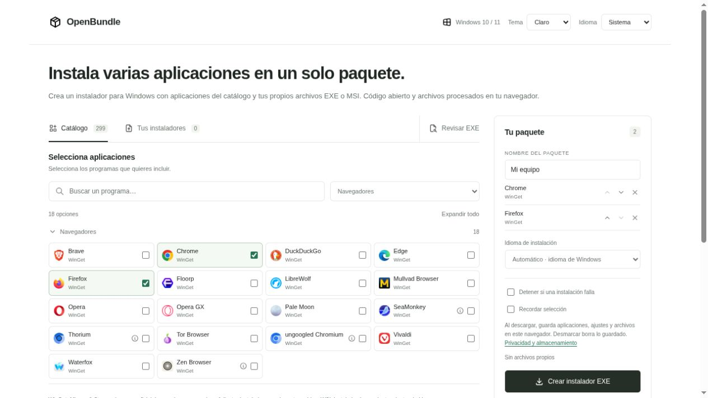
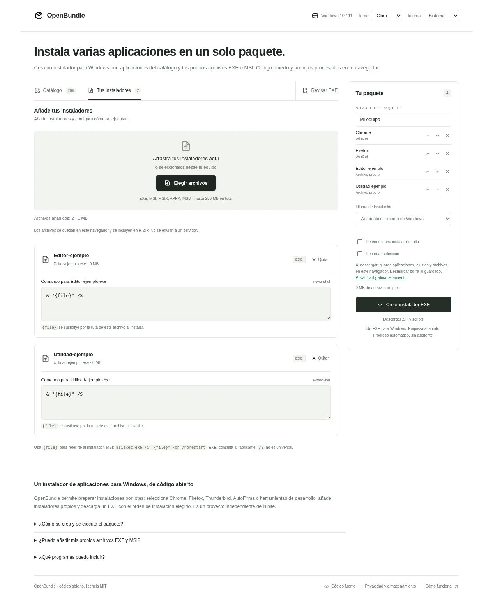
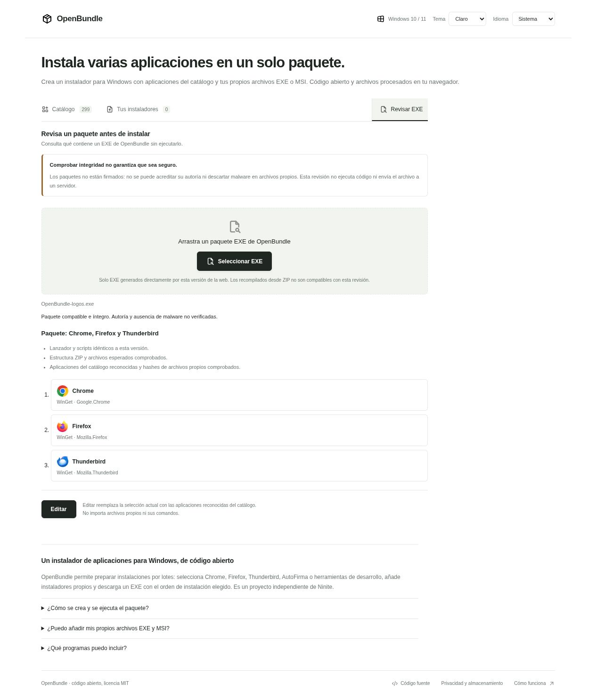
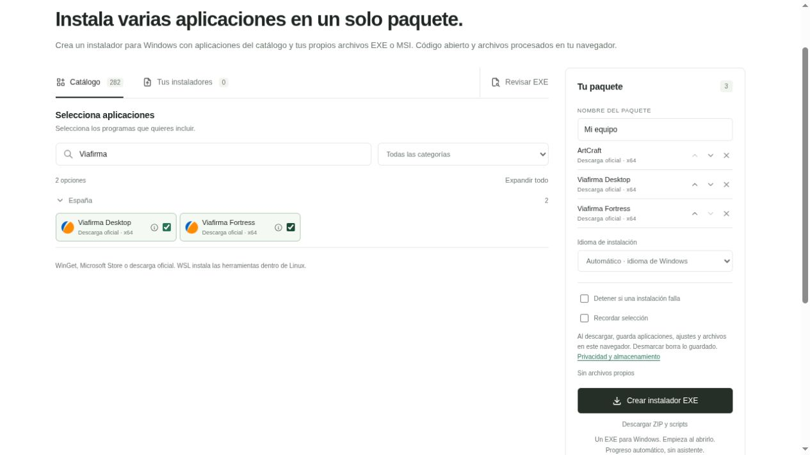
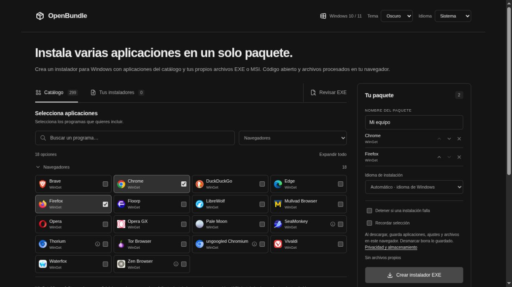
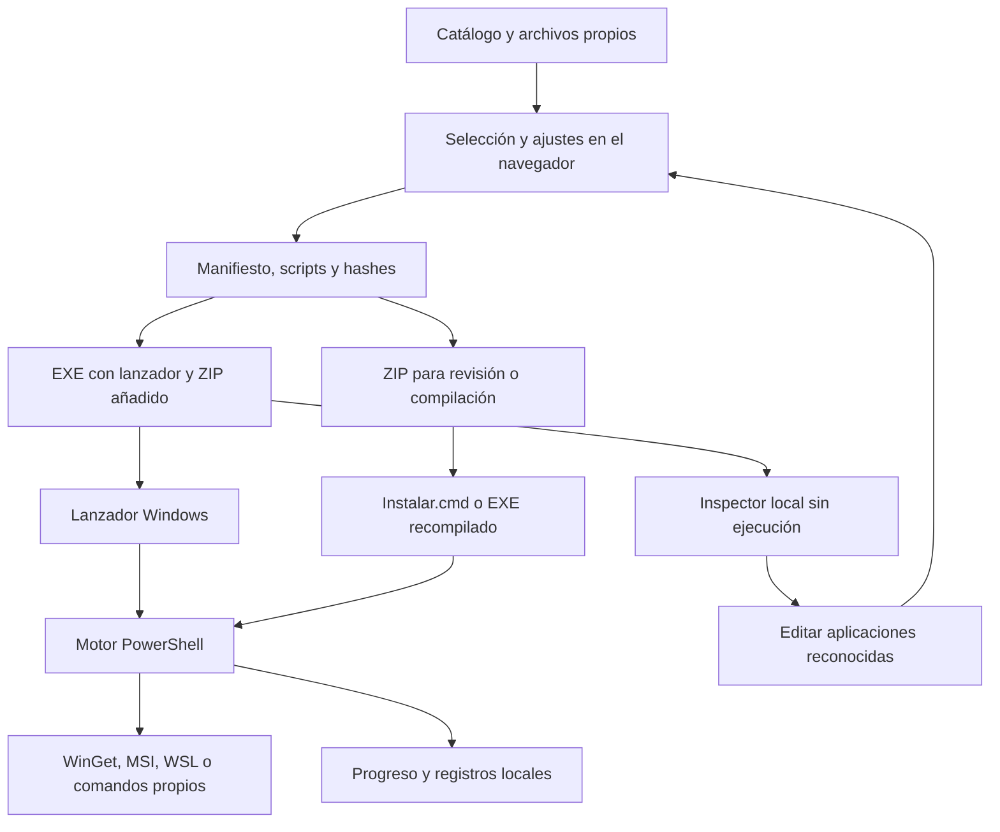

# OpenBundle

**Prepara un paquete de instalación para Windows con las aplicaciones que necesitas y tus propios instaladores.**

OpenBundle es una aplicación web de código abierto: eliges programas de un catálogo, añades archivos EXE o MSI con su comando de instalación y descargas un ejecutable que organiza su instalación en el equipo de destino. La generación del paquete se realiza en el navegador, sin subir tus archivos a un servidor.

El proyecto está inspirado en el flujo de selección de Ninite y es independiente de él. El código de OpenBundle se distribuye bajo [licencia MIT](LICENSE); las aplicaciones del catálogo y sus marcas conservan sus propias licencias.

**Estado: [vista previa experimental 0.3.0](https://github.com/abelsrzz/openbundle/releases/tag/v0.3.0).** La instalación por lotes y la distribución pública todavía requieren validación adicional. La descarga EXE de la web está sin firma. Se han ejecutado cuatro casos iniciales en Windows 11, incluidas instalaciones de 7-Zip y Notepad++. La suite completa del lanzador corregido sigue pendiente; consulta [el alcance de validación](docs/WINDOWS-VALIDATION.md).



## Contenido

- [Funciones principales](#funciones-principales)
- [Empezar en localhost](#empezar-en-localhost)
- [Requisitos](#requisitos)
- [Crear un paquete](#crear-un-paquete)
- [Añadir instaladores propios](#añadir-instaladores-propios)
- [Ejecutar el paquete en Windows](#ejecutar-el-paquete-en-windows)
- [Revisar y editar un EXE](#revisar-y-editar-un-exe)
- [Catálogo y métodos de instalación](#catálogo-y-métodos-de-instalación)
- [Tema, idiomas y preferencias](#tema-idiomas-y-preferencias)
- [Privacidad y almacenamiento](#privacidad-y-almacenamiento)
- [Seguridad, firma y SmartScreen](#seguridad-firma-y-smartscreen)
- [Cómo funciona](#cómo-funciona)
- [Desarrollo y pruebas](#desarrollo-y-pruebas)
- [GitHub Pages y SEO](#github-pages-y-seo)
- [Resolución de problemas](#resolución-de-problemas)
- [Preguntas frecuentes](#preguntas-frecuentes)
- [Contribuir y documentación](#contribuir-y-documentación)
- [Licencias y atribuciones](#licencias-y-atribuciones)

## Funciones principales

| Función | Qué permite |
| --- | --- |
| Catálogo | Buscar y seleccionar entre 282 opciones agrupadas por función, con logos y notas de requisitos. |
| Instaladores propios | Añadir EXE, MSI, MSIX, APPX o MSU y asignar un comando distinto a cada archivo. |
| Paquetes EXE | Generar un ejecutable Windows que comienza al abrirse y muestra el progreso. |
| Alternativa ZIP | Descargar manifiesto, scripts, instaladores adjuntos y fuente del lanzador para revisarlos o recompilar. |
| Orden y errores | Reordenar aplicaciones y elegir si detener el proceso cuando falla una instalación. |
| Revisar EXE | Consultar el contenido declarado de un paquete compatible sin ejecutarlo; ver logos y recuperar aplicaciones del catálogo con **Editar**. |
| Recordar selección | Guardar localmente la selección, ajustes, archivos y comandos al descargar un paquete. |
| Apariencia | Tema Sistema, Claro y Oscuro; el modo oscuro utiliza negro y gris. |
| Idiomas | Español, inglés, francés, alemán, portugués e italiano, con detección del navegador. |
| Distribución estática | Servir la web en localhost o preparar un despliegue manual en GitHub Pages. |

Las opciones de catálogo no implican que todas las aplicaciones tengan instalación automática ni que hayan sido probadas en Windows. Todas las opciones del catálogo tienen una vía automática definida; pueden requerir cuenta, licencia, WinGet o una distribución WSL ya preparada. Los archivos propios se añaden en Tus instaladores.

## Empezar en localhost

Desde la carpeta que contiene este README:

```sh
npm start
```

Abre [http://localhost:8765/](http://localhost:8765/). El comando inicia un servidor estático con Python; mantenlo abierto durante la visita. Para detenerlo, pulsa `Ctrl+C` en esa terminal.

También puedes arrancarlo sin Node ni npm, limitado al equipo local:

```sh
python3 -m http.server 8765 --bind 127.0.0.1 --directory dist
```

En un entorno Windows donde Python se inicia mediante `py`:

```powershell
py -3 -m http.server 8765 --bind 127.0.0.1 --directory dist
```

No es necesario ejecutar `npm install`: la web no utiliza dependencias npm externas. Necesitas obtener o extraer previamente el código fuente del proyecto. Estos comandos no crean un repositorio remoto ni publican el sitio.

**Sirve la carpeta `dist/`; no abras `index.html` mediante `file://`.** La aplicación carga recursos locales con `fetch`, utiliza módulos JavaScript y necesita Web Crypto. Usa localhost durante el desarrollo y HTTPS para alojarla públicamente.

## Requisitos

| Entorno | Requisitos |
| --- | --- |
| Crear y revisar paquetes | Navegador moderno con módulos JavaScript, Web Crypto, Blob, File y Web Workers; conexión para cargar la web. IndexedDB es necesario sólo para recordar la selección. |
| Desarrollo y comprobaciones | Python 3 para el servidor y los scripts de build; Node.js 20 o posterior y npm para las pruebas. |
| Ejecutar paquetes | Windows 10/11, .NET Framework 4.8 y Windows PowerShell 5.1. |
| Aplicaciones WinGet | App Installer/WinGet disponible y acceso a sus fuentes y descargas. |
| Microsoft Store | Acceso a Store; según la aplicación, pueden ser necesarios una cuenta y permisos. |
| Descargas del catálogo | Internet y acceso a los servidores del editor o sus repositorios de releases. |
| Herramientas Linux/WSL | WSL y una distribución compatible Ubuntu/Debian ya instalada e inicializada. |
| Compilar un EXE desde ZIP | Compilador C# de .NET Framework en Windows. |
| Firmar un paquete | SignTool del Windows SDK, certificado válido de firma de código con clave privada y servicio de sello de tiempo. |

La web puede utilizarse desde otros sistemas para preparar el paquete. Eso no permite ejecutar en Linux o macOS los instaladores Windows generados.

## Crear un paquete

### 1. Seleccionar aplicaciones

Abre **Catálogo**, busca por nombre o filtra por categoría y marca las aplicaciones que necesitas. Las categorías pueden expandirse o contraerse. El icono de información, situado a la izquierda del checkbox, abre notas y enlaces sin seleccionar la aplicación.

Cada tarjeta indica su método automático de instalación. El catálogo sólo ofrece opciones que se pueden incluir sin aportar archivos.

### 2. Revisar «Tu paquete»

El panel lateral muestra la selección en el orden en el que se procesará. Usa las flechas para subir o bajar una aplicación y el botón de quitar para retirarla.

| Ajuste | Comportamiento |
| --- | --- |
| Nombre del paquete | Identifica el paquete en su manifiesto y en la alternativa ZIP. |
| Idioma de instalación | Automático conserva la elección de Windows/WinGet; puedes solicitar uno de los idiomas disponibles. Su aplicación depende del instalador. |
| Detener si una instalación falla | Finaliza el procesamiento tras un fallo en lugar de continuar con los siguientes elementos. |
| Recordar selección | Guarda la selección y sus archivos en este navegador cuando se descarga el paquete. |
| Distribución WSL | Aparece al seleccionar herramientas WSL y permite indicar la distribución de destino. |

El idioma de la web y el idioma de instalación son ajustes independientes.

### 3. Descargar

- **Crear instalador EXE** combina el lanzador precompilado, el manifiesto, los scripts y los archivos propios.
- **Descargar ZIP y scripts** entrega esos componentes para su revisión o ejecución mediante scripts.

La descarga se bloquea si no hay elementos seleccionados. También se validan los comandos y las definiciones del paquete.

El nombre predeterminado del EXE sigue el orden de selección:

```text
OpenBundle_Chrome_Firefox_Thunderbird.exe
```

Los espacios y ciertos caracteres se normalizan para formar el nombre del archivo. Cambiar el nombre del paquete en el panel no sustituye esta regla del EXE.

Los instaladores del catálogo normalmente se descargan **al ejecutar el paquete en Windows**. Los archivos propios sí quedan incluidos en la descarga. Seleccionar una aplicación del catálogo no convierte el paquete en un instalador completamente sin conexión.

## Añadir instaladores propios

Abre **Tus instaladores**, pulsa **Elegir archivos** o arrástralos a la zona indicada. Cada archivo tiene su propia tarjeta con nombre, formato, tamaño y campo de comando, para que quede clara la correspondencia.



*Los archivos «Editor-ejemplo» y «Utilidad-ejemplo» de esta captura son fixtures de interfaz, no instaladores reales. No se ejecutaron.*

### Comandos

Los comandos se interpretan como **PowerShell**. Deben incluir `{file}`, que se sustituye por la ruta del instalador adjunto en el equipo de destino. Encierra ese marcador entre comillas para admitir rutas con espacios.

| Formato | Comando inicial |
| --- | --- |
| MSI | `msiexec.exe /i "{file}" /qn /norestart REBOOT=ReallySuppress` |
| EXE | `& "{file}" /S` |
| MSIX / APPX | `Add-AppxPackage -Path "{file}"` |
| MSU | `wusa.exe "{file}" /quiet /norestart` |

**`/S` no es universal.** Consulta los argumentos silenciosos del fabricante y reemplaza el comando sugerido cuando corresponda. Admitir una extensión no garantiza que cualquier paquete de ese tipo se pueda instalar: pueden faltar dependencias, permisos, certificados o soporte en el destino.

Si usas `Start-Process`, utiliza `-Wait` y conserva el código de salida para que el motor pueda detectar el resultado. Por ejemplo, para un EXE cuyo fabricante documente `/S`:

```powershell
$process = Start-Process -FilePath "{file}" -ArgumentList '/S' -Wait -PassThru
exit $process.ExitCode
```

Los comandos propios pueden ejecutar código arbitrario. El autor del paquete debe revisar tanto el archivo como el comando; OpenBundle no puede garantizar silencio, ausencia de extras, actualización o control de reinicios de un EXE ajeno.

### Límites de los archivos propios

El total de archivos propios está limitado a **250 MiB** en la interfaz. El paquete incluye su SHA-256 y verifica la integridad antes de ejecutar cada archivo.

El catálogo no contiene entradas que pidan adjuntar archivos. Para un programa propio, utiliza Tus instaladores y revisa su comando antes de descargar.

## Ejecutar el paquete en Windows

### Ejecutable descargado de la web

Abre el EXE en un Windows compatible. El lanzador está diseñado para comenzar automáticamente, mostrar la lista y el estado de las instalaciones, y permitir consultar registros. Windows o los instaladores pueden pedir elevación UAC, y SmartScreen puede mostrar un aviso de reputación.

La suite inicial se ha ejecutado en Windows; la validación completa de la GUI corregida sigue pendiente. Consulta [validación Windows](docs/WINDOWS-VALIDATION.md) para conocer la evidencia y su alcance.

### ZIP y scripts

1. Extrae **todo** el ZIP en una carpeta.
2. Revisa `manifest.json`, los scripts y los comandos de archivos propios.
3. Abre `Instalar.cmd` para iniciar el motor.
4. Opcionalmente, abre `Crear-EXE.cmd` para compilar `OpenBundle-Setup.exe` con el payload incrustado.

### Simulación e idioma por línea de comandos

Desde PowerShell, para un EXE descargado con esa selección:

```powershell
.\OpenBundle_Chrome_Firefox_Thunderbird.exe --dry-run
.\OpenBundle_Chrome_Firefox_Thunderbird.exe --locale fr-FR
```

Para el EXE recompilado desde ZIP:

```powershell
.\OpenBundle-Setup.exe --dry-run
.\OpenBundle-Setup.exe /locale fr-FR
```

Con los scripts extraídos:

```powershell
.\Instalar.cmd -DryRun
.\Instalar.cmd -Locale es-ES
```

La simulación muestra los pasos previstos sin instalar aplicaciones. No demuestra que una descarga, elevación o instalación vaya a funcionar realmente.

### Registros y reinicios

Los registros se conservan en:

```text
%LOCALAPPDATA%\OpenBundle\Logs
```

Los recibos de las descargas MSI se guardan en:

```text
%LOCALAPPDATA%\OpenBundle\Receipts
```

El motor procesa las aplicaciones de forma secuencial. Para MSI utiliza `/qn /norestart REBOOT=ReallySuppress` y para WinGet no habilita reinicios automáticos. Puede indicar un reinicio pendiente, pero no lo ordena por su cuenta. Un comando propio puede comportarse de otra manera.

## Revisar y editar un EXE

Esta pestaña está separada de la creación de paquetes y analiza el archivo **sin ejecutarlo**.

1. Abre **Revisar EXE** y selecciona o arrastra un paquete compatible.
2. El navegador comprueba su estructura y componentes frente a la versión actual del sitio.
3. La lista muestra las aplicaciones declaradas con sus logos, método e identificador. Los archivos propios aparecen con un icono de archivo, nombre y comando como texto.
4. Pulsa **Editar** para recuperar las aplicaciones reconocidas y continuar en Catálogo.



**Editar reemplaza la selección actual.** Conserva el orden de las aplicaciones reconocidas y los ajustes compatibles del paquete, pero no importa archivos propios ni sus comandos. Si sólo hay archivos propios, el botón permanece deshabilitado.

### Compatibilidad y comprobaciones

El inspector acepta exclusivamente EXE generados directamente por esta versión de la web, con el mismo lanzador y componentes de referencia. Comprueba prefijo PE, cabeceras y entradas ZIP, rutas, duplicados, CRC-32, manifiesto canónico, definiciones del catálogo y SHA-256 de los archivos propios.

No admite EXE genéricos, paquetes de otras versiones, ZIP normales ni EXE recompilados con recurso incrustado, estén firmados o no. Rechazar un archivo por incompatibilidad no significa que sea malware.

El límite de revisión es **252 MiB**; el trabajo se realiza en un Web Worker con un máximo de 30 segundos. Los detalles y límites adicionales están en [INSPECTION.md](INSPECTION.md).

**Compatibilidad e integridad no acreditan autoría ni ausencia de malware.** Un tercero puede generar un paquete estructuralmente válido con archivos o comandos peligrosos. El inspector no es un antivirus ni una sandbox y depende de la confianza en el origen que sirve la web.

## Catálogo y métodos de instalación

La instantánea del catálogo del 14 de octubre de 2026 contiene **282 opciones en 24 categorías**. Las opciones de Ninite sin una vía automática verificable se han excluido. También contiene Affinity, las aplicaciones Craft, programas de España y herramientas de desarrollo.

### Métodos disponibles

| Método | Opciones | Qué sucede al ejecutar |
| --- | ---: | --- |
| WinGet / Microsoft Store | 244 | Se utiliza el identificador y la fuente de la definición del catálogo. |
| Descarga MSI | 20 | Se obtiene un MSI; en repositorios dinámicos se resuelve la última release estable y se exige hash. |
| Linux / WSL | 18 | Se instalan paquetes mediante `apt` dentro de la distribución seleccionada. |

### Categorías

| Categoría | Opciones |
| --- | ---: |
| Navegadores | 18 |
| IA | 10 |
| Comunicación | 9 |
| Imagen y diseño | 17 |
| Multimedia | 15 |
| Documentos y productividad | 10 |
| España | 5 |
| Seguridad y contraseñas | 5 |
| Redes y acceso remoto | 11 |
| Almacenamiento y archivos | 6 |
| Compresión | 3 |
| Utilidades | 13 |
| Juegos | 2 |
| Impresión 3D | 2 |
| Desarrollo · Lenguajes | 35 |
| Desarrollo · Compiladores y construcción | 10 |
| Desarrollo · Editores e IDE | 15 |
| Desarrollo · Herramientas | 15 |
| Desarrollo · Bases de datos | 5 |
| Desarrollo · Contenedores e infraestructura | 5 |
| Desarrollo · Linux / WSL | 18 |
| Runtimes · .NET | 20 |
| Runtimes · Java | 20 |
| Runtimes · Visual C++ | 13 |

La sección IA incluye ChatGPT, Claude, LM Studio, Ollama y otras herramientas. Algunos asistentes requieren una cuenta o suscripción; los modelos locales se descargan aparte. El catálogo no ofrece entradas que requieran adjuntar un instalador.



Consulta [CATALOG.md](CATALOG.md) para la lista con fuentes y [dist/catalog.json](dist/catalog.json) para las definiciones que utiliza la aplicación.

### Políticas y alcance

WinGet conserva su comprobación de integridad e intenta instalar o actualizar la versión aplicable del identificador seleccionado. Las descargas MSI dinámicas rechazan releases draft/prerelease y necesitan un SHA-256 verificable. El motor compara versiones MSI y puede omitir versiones iguales o superiores, sin utilizar `Win32_Product`.

Los paquetes no fijan necesariamente versiones reproducibles: una definición dinámica puede descargar una release posterior cuando se ejecute. Los archivos propios sí contienen la versión adjuntada al crearlos.

Las descargas directas usan la configuración de proxy del sistema; PAC, bypass y determinados entornos WinGet requieren validación específica. La compatibilidad de arquitectura y el idioma dependen también de los instaladores y las fuentes disponibles.

No se garantiza paridad completa con Ninite, ausencia de extras, ni que todas las URLs de los manifests comunitarios hayan sido auditadas por editor. Consulta la comparación de comportamientos en [PARITY.md](PARITY.md).

## Tema, idiomas y preferencias

### Sistema, Claro y Oscuro

El selector de la cabecera empieza en **Sistema** y sigue `prefers-color-scheme`. Puedes forzar Claro u Oscuro; la elección se guarda localmente. Volver a Sistema elimina la preferencia explícita.



El favicon también responde a la preferencia de color que comunica el navegador. Puede diferir del tema manual que selecciones dentro de la página.

### Idiomas

La web y la guía están disponibles en español, inglés, francés, alemán, portugués e italiano. **Sistema** consulta los idiomas preferidos del navegador y usa el primero disponible, incluyendo variantes regionales mediante el idioma base; si ninguno coincide, utiliza inglés.

Una elección explícita se conserva localmente. Cambiar de idioma no traduce nombres comerciales, archivos o comandos y no cambia el idioma de instalación Windows. La ventana del lanzador Windows no tiene todavía la misma cobertura multilingüe de la web.

Para mantener traducciones, consulta [LOCALIZATION.md](LOCALIZATION.md).

## Privacidad y almacenamiento

La generación y la revisión de paquetes se realizan en el navegador. La implementación actual no utiliza cookies, analítica ni envíos de instaladores o comandos a un servidor. El alojamiento recibe las peticiones normales necesarias para servir la web y puede conservar registros HTTP según su configuración; los enlaces externos llevan a sus respectivos sitios.

| Datos | Almacenamiento | Cuándo se guardan |
| --- | --- | --- |
| Selección, orden, nombre y opciones | IndexedDB | Al descargar con **Recordar selección** marcado. |
| Instaladores propios y comandos | IndexedDB junto a la selección | Sólo con esa misma opción al descargar. |
| Tema manual | localStorage | Al seleccionar Claro u Oscuro. |
| Idioma manual | localStorage | Al elegir un idioma explícito. |
| Archivo cargado para revisión | Memoria durante el análisis | No se añade a la selección guardada ni se sube. |
| EXE o ZIP descargado | Carpeta de descargas del usuario | Al descargar; queda fuera del almacenamiento interno del sitio. |

Desmarcar **Recordar selección** elimina la selección guardada por la web. También puedes borrar los datos del sitio desde tu navegador. Esto no borra los EXE o ZIP que ya hayas descargado.

Los datos están vinculados al navegador y al origen: no se sincronizan entre equipos y no migran automáticamente de localhost a GitHub Pages. La navegación privada, la cuota o las políticas del navegador pueden impedir persistirlos. Un error de almacenamiento se notifica sin impedir la descarga.

Si recuerdas instaladores privados, sus bytes quedan guardados en ese perfil del navegador. Consulta también la sección de [privacidad de la guía](dist/guide.html#privacidad).

## Seguridad, firma y SmartScreen

Los EXE descargados directamente de la web **no tienen firma de distribución**. El aviso «Windows protegió su PC» puede deberse a reputación desconocida de SmartScreen; no constituye por sí solo una detección de malware ni una garantía de seguridad.

Existe un flujo opcional de compilación y firma del paquete completo en Windows mediante `build-exe.ps1`. Requiere certificado válido de firma de código y SignTool; utiliza SHA-256, sello de tiempo y verificación antes de copiar el resultado a la carpeta de salida. No se ha firmado todavía un artefacto real del proyecto.

La firma identifica al editor y protege la integridad, pero [Microsoft explica que un ejecutable firmado puede seguir mostrando avisos mientras adquiere reputación](https://learn.microsoft.com/en-us/windows/apps/package-and-deploy/smartscreen-reputation). No se entrega ninguna clave privada al navegador ni se firma automáticamente contenido arbitrario de usuarios.

Lee [SIGNING.md](SIGNING.md) para el procedimiento y sus límites, y [SECURITY.md](SECURITY.md) para comunicar vulnerabilidades. No publiques información sensible ni exploits en issues públicos.

## Cómo funciona



### Dos formatos de EXE

| Formato | Generación | Inspector actual |
| --- | --- | --- |
| EXE del navegador | Lanzador precompilado más ZIP32 sin compresión con offsets absolutos. | Admitido si coincide con esta versión. |
| EXE recompilado | C# compilado con el ZIP como recurso `Payload`; puede firmarse después de incorporar el contenido completo. | No admitido. |

El lanzador extrae el contenido a una carpeta temporal, lee el manifiesto y ejecuta el motor PowerShell. La ventana consulta los datos de progreso y los registros quedan en el perfil local del usuario.

### Contenido de la alternativa ZIP

```text
LICENSE.txt
manifest.json
install-policy.ps1
install.ps1
Launcher.cs
build-exe.ps1
Instalar.cmd
Crear-EXE.cmd
LEEME.txt
installers/           # sólo si se adjuntaron archivos propios
```

El manifiesto utiliza `schemaVersion: 3`. Este ejemplo simplificado describe dos aplicaciones del catálogo:

```json
{
  "schemaVersion": 3,
  "name": "Mi equipo",
  "stopOnError": true,
  "wslDistribution": "Ubuntu",
  "locale": "auto",
  "items": [
    { "type": "winget", "name": "Chrome", "id": "Google.Chrome", "source": "winget" },
    { "type": "winget", "name": "Firefox", "id": "Mozilla.Firefox", "source": "winget" }
  ]
}
```

El inspector exige la representación canónica y componentes exactos del generador. Modificar manualmente un manifiesto puede volver el paquete incompatible con esa revisión; usa **Editar** y vuelve a generarlo cuando sea posible.

## Desarrollo y pruebas

### Estructura del proyecto

```text
openbundle/
├── dist/                         # web y componentes que empaqueta
│   ├── index.html, guide.html    # creador y guía
│   ├── app.js, style.css         # interfaz y estilos
│   ├── theme.js, i18n.js         # apariencia e idioma
│   ├── locales/messages.json    # traducciones
│   ├── catalog.json             # definiciones de aplicaciones
│   ├── catalog-coverage.json     # cobertura de la referencia
│   ├── logos/, icons/           # marcas y Tabler Icons locales
│   ├── package.js               # validación, manifiesto y ZIP/EXE
│   ├── download-name.js         # nombre del EXE
│   ├── selection-storage.js     # persistencia IndexedDB
│   ├── inspect-package.js       # parser estricto sin ejecución
│   ├── inspection-worker.js     # análisis en Web Worker
│   ├── Launcher.cs              # fuente WinForms
│   ├── openbundle-launcher.exe  # lanzador Windows precompilado
│   ├── runner.ps1               # motor de instalación
│   ├── install-policy.ps1       # políticas y helpers
│   └── build-exe.ps1            # recompilar y firmar el paquete
├── scripts/                     # launcher, Pages, SEO y comprobaciones
├── tests/                       # pruebas Node
├── docs/screenshots/            # capturas de este README
├── .github/                     # plantillas, CODEOWNERS y flujo manual
├── build/pages/                 # artefacto generado; no versionado
└── package.json
```

### Comprobaciones

```sh
npm test
npm run check:locales
npm run build:pages
npm run check:pages
```

| Comprobación | Alcance |
| --- | --- |
| `npm test` | 22 pruebas actuales de catálogo, validación, manifiesto, ZIP/EXE, persistencia e inspector ante alteraciones. |
| `check:locales` | Cobertura de traducciones, parámetros y textos estáticos y del catálogo. |
| `build:pages` | Crea el artefacto estático y el archivo de fuentes; no publica. |
| `check:pages` | Verifica recursos, enlaces, anclas, logos, metadatos, launcher y archivo de fuentes. |

También se han realizado comprobaciones del parser PowerShell y escenarios simulados del motor, helpers y firma. Son verificaciones distintas de ejecutar instaladores reales. [TESTING.md](TESTING.md) explica cómo documentar y ampliar las pruebas en Windows.

### Cambiar catálogo, traducciones o lanzador

- **Catálogo:** edita `dist/catalog.json`, conserva claves estables y documenta fuentes y licencias. Actualiza cobertura, recuentos y [CATALOG.md](CATALOG.md); regenera el HTML del catálogo con `python3 scripts/build-seo.py`.
- **Traducciones:** actualiza `dist/locales/messages.json` y conserva marcadores como `{name}`, `{count}` y `{file}`. Comprueba con `npm run check:locales`.
- **Lanzador:** si cambias `dist/Launcher.cs`, recompila el binario correspondiente en Windows:

```powershell
powershell -File scripts/build-launcher.ps1
```

Ese comando recompila el lanzador sin firmarlo. La firma del paquete completo se trata por separado en [SIGNING.md](SIGNING.md).

Los cambios de scripts o binario pueden hacer que paquetes anteriores dejen de ser compatibles con el inspector actual. Verifica una fixture nueva y casos alterados antes de distribuir cambios.

## GitHub Pages y SEO

El destino previsto es `abelsrzz/openbundle`, con URL de proyecto `https://abelsrzz.github.io/openbundle/`. **Es un destino preparado, no una publicación disponible.**

```sh
npm run build:pages
npm run check:pages
```

El resultado queda en `build/pages/`, con `.nojekyll`, metadatos, URL canónicas, sitemap y ZIP de fuentes. El workflow de Pages sólo utiliza `workflow_dispatch`; un push no despliega automáticamente. Consulta [DEPLOYMENT.md](DEPLOYMENT.md) antes de una futura publicación.

Para preparar el artefacto para otro dominio:

```sh
python3 scripts/build-pages.py --base-url https://example.org/openbundle/
```

El dominio del ejemplo debe sustituirse por el destino real. El build no modifica el dominio del código de desarrollo en `dist/` ni publica el sitio.

La portada y la guía incluyen títulos, descripciones, Open Graph, Twitter Cards y JSON-LD. La guía ofrece el catálogo como HTML estático. El selector de idioma traduce la interfaz; no existen rutas independientes por idioma ni se anuncian etiquetas `hreflang` para páginas que no se sirven.

GitHub Pages puede alojar la web estática, pero no ejecutar un servicio de firma por selección ni instalar aplicaciones en el equipo del visitante.

## Resolución de problemas

| Problema | Qué revisar |
| --- | --- |
| Localhost no responde | El servidor debe seguir ejecutándose desde la raíz del proyecto y servir `dist/`. Revisa la URL y el puerto; si 8765 está ocupado, utiliza otro puerto en el comando. |
| Cambios visuales no aparecen | Recarga la página y, si conserva recursos anteriores, fuerza una recarga sin caché. |
| No se puede descargar | Comprueba que haya selección, que cada comando propio incluya `{file}`. |
| La selección no se recuerda | Marca Recordar selección antes de descargar; utiliza el mismo navegador/origen y comprueba cuota o bloqueo del almacenamiento. |
| «Windows protegió su PC» | La descarga web está sin firma; revisa [SIGNING.md](SIGNING.md). No se garantiza que una firma elimine inmediatamente el aviso. |
| Defender muestra un nombre de amenaza | Es distinto del aviso de reputación. No ejecutes el paquete para probarlo; conserva el nombre de detección y revisa la procedencia y contenido. |
| WinGet no está disponible | Revisa App Installer/WinGet en el Windows de destino y consulta los registros. |
| La opción WSL falla | Comprueba que la distribución indicada exista, esté inicializada y admita los paquetes `apt` seleccionados. |
| Un EXE propio abre un asistente | Sus argumentos no son silenciosos o no son válidos para ese fabricante; revisa el comando de esa tarjeta. |
| Una descarga MSI falla por hash | No sustituyas la verificación: comprueba el release y la metadata oficial y actualiza la definición si corresponde. |
| El inspector rechaza el EXE | Debe haber sido generado directamente por esta versión de la web. Recompilaciones, firmas, cambios y versiones anteriores pueden ser incompatibles. |
| Editar no recupera todos los elementos | Recupera únicamente aplicaciones reconocidas del catálogo; excluye archivos propios y comandos. |
| El idioma solicitado no se aplica | Puede no existir un instalador compatible en ese idioma; el fallback depende del método y queda registrado. |

Para incidencias del motor, adjunta versión de Windows, arquitectura, aplicaciones y extractos de registros sin datos privados. Consulta los canales del proyecto en [ayuda y propuestas](PROJECT.md#ayuda-y-propuestas).

## Preguntas frecuentes

### ¿Es una alternativa oficial a Ninite?

No. Es un proyecto independiente que busca un flujo similar y añade instaladores propios. [PARITY.md](PARITY.md) distingue comportamientos implementados, límites y pruebas pendientes.

### ¿Se incluyen los instaladores del catálogo dentro del EXE?

Normalmente no: se incluyen sus definiciones y se descargan en el destino. Los instaladores propios sí se incluyen como bytes del paquete.

### ¿Funciona sin conexión?

Depende de la selección. WinGet, Store, releases remotas y algunos instaladores necesitan Internet. Un paquete formado sólo por archivos propios puede seguir teniendo dependencias o pasos de red definidos por sus fabricantes.

### ¿Actualiza programas que ya están instalados?

El motor intenta usar el comportamiento de WinGet y la comparación de versiones MSI. No se promete actualización u omisión correcta para cualquier EXE propio ni para todos los estados de instalación. Revisa los registros.

### ¿Se pueden guardar varias selecciones?

Por ahora se conserva una selección recordada por navegador/origen. No hay perfiles múltiples ni sincronización entre dispositivos.

### ¿El inspector garantiza que un archivo es de OpenBundle y es seguro?

Verifica que cumple el formato y coincide con los componentes actuales; no autentica al autor. Tampoco certifica los comandos, los instaladores propios ni lo que descarguen posteriormente las aplicaciones.

### ¿El navegador firma el EXE?

No. Existe compilación con firma opcional en Windows, pero falta un certificado de distribución del proyecto. La firma del paquete personalizado completo no se resuelve firmando sólo el launcher.

### ¿OpenBundle elimina aplicaciones o revierte una instalación fallida?

No hay una función general de desinstalación ni rollback. El instalador puede haber cambiado el equipo antes de fallar; por eso las pruebas reales deben hacerse en un entorno Windows apropiado.

### ¿Cómo se mantienen las capturas?

Son capturas reales de localhost del 13 de octubre de 2026, tomadas sin ejecutar instaladores. Los archivos están en [docs/screenshots](docs/screenshots/README.md); deben actualizarse cuando cambie la interfaz. No son maquetas de una ejecución Windows.

## Contribuir y documentación

Son útiles las contribuciones de catálogo, traducciones, accesibilidad, documentación, seguridad y validación Windows. Lee [CONTRIBUTING.md](CONTRIBUTING.md) y [CODE_OF_CONDUCT.md](CODE_OF_CONDUCT.md). Explica el problema, el comportamiento resultante y las comprobaciones realizadas; para cambios visuales incluye capturas.

| Documento | Contenido |
| --- | --- |
| [PROJECT.md](PROJECT.md) | Mantenimiento, responsables, ayuda y prioridades. |
| [CONTRIBUTING.md](CONTRIBUTING.md) | Preparar cambios y contribuir. |
| [CODE_OF_CONDUCT.md](CODE_OF_CONDUCT.md) | Participación y moderación. |
| [SECURITY.md](SECURITY.md) | Reporte de vulnerabilidades y estado de los canales privados. |
| [TESTING.md](TESTING.md) | Verificación y pruebas Windows. |
| [RELEASING.md](RELEASING.md) | Preparar futuras versiones. |
| [DEPLOYMENT.md](DEPLOYMENT.md) | Preparar y desplegar GitHub Pages. |
| [SIGNING.md](SIGNING.md) | Firma Authenticode y SmartScreen. |
| [docs/WINDOWS-VALIDATION.md](docs/WINDOWS-VALIDATION.md) | Resultados Windows y límites de la vista previa. |
| [DISTRIBUTION.md](DISTRIBUTION.md) | Evaluación de formatos y opciones de distribución y firma. |
| [INSPECTION.md](INSPECTION.md) | Formato admitido y límites del inspector. |
| [LOCALIZATION.md](LOCALIZATION.md) | Idiomas y mantenimiento de traducciones. |
| [CATALOG.md](CATALOG.md) | Aplicaciones y fuentes del catálogo. |
| [PARITY.md](PARITY.md) | Comparación de comportamientos con Ninite. |
| [CHANGELOG.md](CHANGELOG.md) | Cambios relevantes, todavía sin publicación oficial. |
| [ASSETS.md](ASSETS.md) | Procedencia y atribuciones de recursos gráficos. |

Las plantillas de issues y pull requests y `CODEOWNERS` están en `.github/`. El mantenedor inicial es `@abelsrzz`. El reporte privado de vulnerabilidades está habilitado; consulta [SECURITY.md](SECURITY.md). La política de conducta describe sus canales disponibles.

## Licencias y atribuciones

- **Código de OpenBundle:** [MIT](LICENSE).
- **Logos y marcas de aplicaciones:** derechos de sus propietarios; consulta [ASSETS.md](ASSETS.md).
- **Iconos de interfaz:** Tabler Icons; licencia incluida en [dist/icons/LICENSE](dist/icons/LICENSE).
- **Aplicaciones y archivos incluidos por usuarios:** conservan sus licencias y condiciones. Debes tener derecho a utilizarlos y distribuirlos.

OpenBundle no concede licencias de terceros ni evita requisitos de cuenta, suscripción o activación de las aplicaciones.
